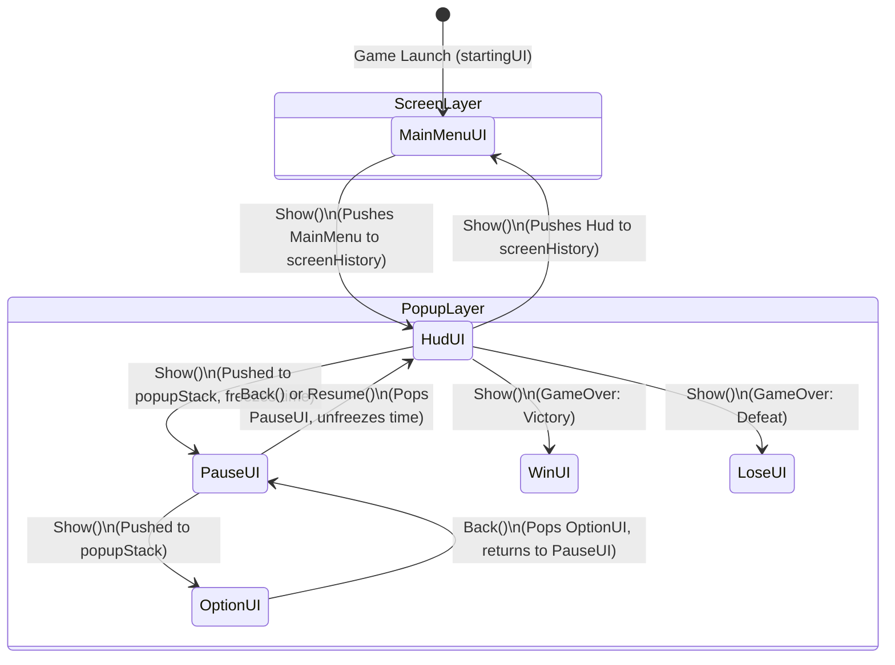

# UI ArtLake Package Documentation

> **Package Identifier**: `ArtLake.UI`  
> **Target Unity Version**: Unity 6.6
> **UI Framework**: Unity UGUI (`UnityEngine.UI`) + `CanvasGroup` + Input System  
> **Target Audience**: AI Coding Agents, Systems Designers, Gameplay Engineers  

---

## 📑 Table of Contents

1. [Package Overview & Design Philosophy](#1-package-overview--design-philosophy)
2. [Core Architecture & State Machine](#2-core-architecture--state-machine)
3. [Component & API Reference](#3-component--api-reference)
   - [IGameUI & PanelType](#igameui--paneltype)
   - [BaseUI](#baseui)
   - [UIManager](#uimanager)
   - [Screen Panels: MainMenuUI & HudUI](#screen-panels-mainmenuui--hudui)
   - [Popup Panels: PauseUI, OptionUI, WinUI, LoseUI](#popup-panels-pauseui-optionui-winui-loseui)
4. [Prefab Specification (`_UI.prefab`)](#4-prefab-specification-_uiprefab)
5. [AI Agent Reasoning & Invariants Guide](#5-ai-agent-reasoning--invariants-guide)
6. [Cookbook & Implementation Recipes](#6-cookbook--implementation-recipes)
   - [Recipe 1: Triggering UI from Gameplay Scripts](#recipe-1-triggering-ui-from-gameplay-scripts)
   - [Recipe 2: Creating a New Screen (e.g., Shop/Inventory)](#recipe-2-creating-a-new-screen)
   - [Recipe 3: Creating a Stackable Modal/Popup](#recipe-3-creating-a-stackable-modalpopup)
   - [Recipe 4: Subscribing to UI Events (Decoupled Architecture)](#recipe-4-subscribing-to-ui-events)
   - [Recipe 5: Runtime Instantiation & Dynamic Registration](#recipe-5-runtime-instantiation--dynamic-registration)
   - [Recipe 6: New Input System Migration](#recipe-6-new-input-system-migration)
7. [Pitfalls, Invariants & Anti-Patterns](#7-pitfalls-invariants--anti-patterns)

---

## 1. Package Overview & Design Philosophy

`UI ArtLake` is a lightweight, high-performance, architecture-driven UI framework for Unity games. It eliminates spaghetti UI code by replacing direct GameObject toggling with a central **Type-indexed Registry**, a **Dual-Mode Stack (Screens vs. Popups)**, and **CanvasGroup-based visibility caching**.

### Key Architectural Pillars

* **CanvasGroup Toggling over GameObject Deactivation**:  
  Panels are **never** deactivated using `gameObject.SetActive(false)`. Instead, visibility, interactivity, and raycasting are controlled via `CanvasGroup.alpha`, `interactable`, and `blocksRaycasts`.  
  *Benefit*: Zero garbage collection spikes, no Awake/Start lifecycle churn, no layout re-calculations on toggle, and running coroutines/tweens are safely preserved.
* **Type-Based Singleton Registry**:  
  Every panel inherits from `BaseUI` and is indexed in `UIManager` by its C# `System.Type`. All access is type-safe: `UIManager.Instance.Show<HudUI>()`, avoiding magic strings or scene-searching.
* **Dual Hierarchy Concept (Screen vs. Popup)**:  
  * **Screen**: Exclusive, full-view game state (e.g., `MainMenuUI`, `HudUI`). Showing a Screen automatically clears all popups, saves the old screen to history, and presents the new one.  
  * **Popup**: Modal overlay (e.g., `PauseUI`, `OptionUI`, `WinUI`, `LoseUI`). Popups stack on top of screens and other popups in a LIFO stack.
* **Unified Back Navigation**:  
  A single call to `UIManager.Instance.Back()` intelligently closes the topmost popup first; once all popups are closed, it steps backwards through the screen history.

---

## 2. Core Architecture & State Machine

### 2.1 Navigation & Layering State Flow



### 2.2 Screen vs. Popup Decision Matrix

| Dimension | `PanelType.Screen` | `PanelType.Popup` |
| :--- | :--- | :--- |
| **Primary Role** | Major game scenes/states (`MainMenu`, `HUD`, `GameOverScreen`) | Overlays, Modals, Dialogs (`Pause`, `Options`, `Alert`) |
| **Concurrency** | **Exclusive** (Only 1 active Screen at any moment) | **Stackable** (Multiple popups can sit on top of each other) |
| **On Show Action** | Closes current screen, pushes it to `screenHistory`, and calls `CloseAllPopups()` | Pushes self to `popupStack`, opens over existing Screen/Popups |
| **On Back Action** | Pops previous screen from `screenHistory` and reopens it | Pops self from `popupStack` and closes; reveals underneath popup/screen |

---

## 3. Component & API Reference

### IGameUI & PanelType
**File**: `Assets/UI ArtLake/Scripts/IGameUI.cs` & `BaseUI.cs`

```csharp
namespace ArtLake.UI
{
    public enum PanelType
    {
        Screen, // Exclusive full view
        Popup   // Stackable modal/overlay
    }

    public interface IGameUI
    {
        PanelType Type { get; }
        bool IsOpen { get; }
        void Open();
        void Close();
    }
}
```

---

### BaseUI
**File**: `Assets/UI ArtLake/Scripts/BaseUI.cs`  
**Inherits**: `MonoBehaviour`, `IGameUI`  
**Attributes**: `[RequireComponent(typeof(CanvasGroup))]`

The abstract base class for all panels. It manages CanvasGroup state and provides lifecycle extension hooks.

#### Fields & Properties
* `[SerializeField] protected PanelType panelType`: Determines whether this panel acts as a Screen or Popup.
* `public PanelType Type => panelType`: Read-only accessor for panel type.
* `public bool IsOpen { get; private set; }`: `true` when the panel is visible and interactive.
* `protected CanvasGroup canvasGroup`: Cached reference to the local `CanvasGroup`.

#### Core Methods
* `public virtual void Open()`:
  * Ensures `CanvasGroup` is present.
  * Sets `alpha = 1f`, `interactable = true`, `blocksRaycasts = true`.
  * Sets `IsOpen = true`.
  * Invokes `OnOpen()`.
* `public virtual void Close()`:
  * Ensures `CanvasGroup` is present.
  * Sets `alpha = 0f`, `interactable = false`, `blocksRaycasts = false`.
  * Sets `IsOpen = false`.
  * Invokes `OnClose()`.
* `public void SetActive(bool active)`: Convenience helper invoking `Open()` if `true`, or `Close()` if `false`.
* `protected virtual void OnOpen()`: Override in derived classes for open logic (animations, SFX, pausing time).
* `protected virtual void OnClose()`: Override in derived classes for close logic (cleanup, unpausing).

---

### UIManager
**File**: `Assets/UI ArtLake/Scripts/UIManager.cs`  
**Inherits**: `MonoBehaviour`  
**Pattern**: Singleton with optional `DontDestroyOnLoad`.

The brain of the UI system. Handles registration, lookup, screen switching, popup stacking, and backward navigation.

#### Serialized Configuration
* `[SerializeField] private bool isPersistent = true`: When enabled, marks `UIManager` as `DontDestroyOnLoad`.
* `[SerializeField] private Transform uiContainer`: Root transform containing all panel child GameObjects (defaults to `this.transform`).
* `[SerializeField] private BaseUI startingUI`: The screen or popup automatically opened on `Awake()`.

#### Public Properties
* `public static UIManager Instance { get; private set; }`: Static singleton reference.
* `public BaseUI CurrentScreen => currentScreen`: Returns the currently active `PanelType.Screen`.
* `public int ActivePopupCount => popupStack.Count`: Number of popups currently in the popup stack.

#### Public API

```csharp
// --- OPENING / SHOWING ---
public T Show<T>() where T : BaseUI;
public void Show(BaseUI panel);

// --- CLOSING / HIDING ---
public void Hide<T>() where T : BaseUI;
public void Hide(BaseUI panel);
public void CloseAllPopups();

// --- NAVIGATION ---
public bool Back(); // Pops top popup or pops previous screen. Returns false if nothing to pop.

// --- QUERY & REGISTRY ---
public T Get<T>() where T : BaseUI;       // Retrieves registered instance without changing visibility
public bool IsOpen<T>() where T : BaseUI;  // Checks if instance is registered and IsOpen == true
public void RegisterUI(BaseUI ui);         // Manually registers a panel (auto-done in Awake for children)
```

---

### Screen Panels: MainMenuUI & HudUI

#### `MainMenuUI` (`Assets/UI ArtLake/Scripts/MainMenuUI.cs`)
* **Type**: `PanelType.Screen`
* **Buttons**:
  * `playButton`: Calls `GoToHud()` -> Triggers `onPlay` UnityEvent, switches screen to `HudUI`.
  * `OptionsButton`: Calls `GoToOptions()` -> Opens `OptionUI` popup.
  * `ExitButton`: Calls `ExitGame()` -> Quits application or stops play mode in Unity Editor.
* **UnityEvents**:
  * `[SerializeField] private UnityEvent onPlay`: Invoked when Play button is pressed.

#### `HudUI` (`Assets/UI ArtLake/Scripts/HudUI.cs`)
* **Type**: `PanelType.Screen`
* **Buttons & Input**:
  * `pauseButton`: Toggles `PauseUI`.
  * `listenToEscapeKey = true`: Listens to `KeyCode.Escape` in `Update()` to toggle `PauseUI`.
* **Methods**:
  * `public void TogglePause()`: If `PauseUI` is open, hides it. Otherwise, shows `PauseUI`.

---

### Popup Panels: PauseUI, OptionUI, WinUI, LoseUI

#### `PauseUI` (`Assets/UI ArtLake/Scripts/PauseUI.cs`)
* **Type**: `PanelType.Popup`
* **Configuration**:
  * `pauseTimeScale = true`: Automatically sets `Time.timeScale = 0f` on `OnOpen()` and restores `Time.timeScale = 1f` on `OnClose()`.
* **Buttons**:
  * `resumeButton`: Calls `Resume()` -> `UIManager.Instance.Hide(this)`.
  * `optionsButton`: Calls `OpenOptions()` -> `UIManager.Instance.Show<OptionUI>()`.
  * `mainMenuButton`: Calls `GoToMainMenu()` -> Restores `Time.timeScale = 1f`, invokes `onMainMenuClicked`, shows `MainMenuUI`.

#### `OptionUI` (`Assets/UI ArtLake/Scripts/OptionUI.cs`)
* **Type**: `PanelType.Popup`
* **Buttons**:
  * `backButton`: Calls `Back()` -> `UIManager.Instance.Back()`.
* **Methods**:
  * `public void GoToMainMenu()`: Directly shows `MainMenuUI`.

#### `WinUI` (`Assets/UI ArtLake/Scripts/WinUI.cs`)
* **Type**: `PanelType.Popup`
* **Buttons & Events**:
  * `restartButton`: Invokes `onRestartClicked`, hides self.
  * `nextLevelButton`: Invokes `onNextLevelClicked`, hides self.
  * `mainMenuButton`: Invokes `onMainMenuClicked`, shows `MainMenuUI`.

#### `LoseUI` (`Assets/UI ArtLake/Scripts/LoseUI.cs`)
* **Type**: `PanelType.Popup`
* **Buttons & Events**:
  * `restartButton`: Invokes `onRestartClicked`, hides self.
  * `mainMenuButton`: Invokes `onMainMenuClicked`, shows `MainMenuUI`.

---

## 4. Prefab Specification (`_UI.prefab`)

**Prefab Path**: `Assets/UI ArtLake/Prefabs/_UI.prefab`

This prefab is the complete, self-contained UI root for any game scene.

```text
_UI (Root GameObject)
├── Components:
│   ├── RectTransform (Stretch anchor: min(0,0), max(1,1))
│   ├── Canvas (Render Mode: Screen Space - Overlay, Additional Shader Channels: TexCoord1)
│   ├── CanvasScaler (UI Scale Mode: Scale With Screen Size, 1920x1080, Match: 0.5)
│   ├── GraphicRaycaster (Blocking Objects: None)
│   └── UIManager (isPersistent: True, startingUI: MainMenu Panel)
│
├── Children Panels (all have RectTransform, CanvasRenderer, Image, CanvasGroup):
│   ├── MainMenu Panel    -> [MainMenuUI] (PanelType: Screen)
│   ├── HUD Panel         -> [HudUI]      (PanelType: Screen)
│   ├── Pause Panel       -> [PauseUI]    (PanelType: Popup, pauseTimeScale: True)
│   ├── Win Panel         -> [WinUI]      (PanelType: Popup)
│   ├── Lose Panel        -> [LoseUI]     (PanelType: Popup)
│   ├── Option Panel      -> [OptionUI]   (PanelType: Popup)
│   └── EventSystem       -> [EventSystem, InputSystemUIInputModule]
```

### Quick Scene Setup
1. Drag `_UI.prefab` into your starting scene hierarchy.
2. Ensure there are **no duplicate EventSystems** in the scene (if your scene already has one, remove it or delete the one inside `_UI`).
3. Hit Play: `UIManager.Awake()` will discover all children panels, initialize them to `alpha = 0` (closed), and open `startingUI` (`MainMenuUI`).

---

## 5. AI Agent Reasoning & Invariants Guide

When an AI agent is instructed to interact with, modify, or extend `UI ArtLake`, it **must adhere to these deterministic rules**:

### 🤖 Deterministic Decision Rules for AI Agents

1. **Never use `gameObject.SetActive()` for visibility**:
   * ❌ WRONG: `UIManager.Instance.Get<HudUI>().gameObject.SetActive(false);`
   * ✅ CORRECT: `UIManager.Instance.Hide<HudUI>();`
2. **Never register multiple panels of the same Type**:
   * `UIManager` uses `Dictionary<Type, BaseUI>`. Calling `RegisterUI` with two distinct GameObjects holding `ShopUI` will overwrite the first one.
   * If you need duplicate instances (e.g. multiple modal popups), create specialized subclasses (`ItemShopUI`, `SkillShopUI`) or handle item lists internally inside a single panel.
3. **Always use Generics for UI Operations**:
   * ✅ `UIManager.Instance.Show<PauseUI>();`
   * ✅ `UIManager.Instance.Hide<PauseUI>();`
   * ✅ `bool isPaused = UIManager.Instance.IsOpen<PauseUI>();`
   * ✅ `HudUI hud = UIManager.Instance.Get<HudUI>();`
4. **TimeScale Invariant**:
   * If a custom panel freezes time (`Time.timeScale = 0f`), it **must** restore `Time.timeScale = 1f` in `OnClose()` and when navigating away to scenes or menus.
5. **Always call `base.OnOpen()` and `base.OnClose()`**:
   * Subclasses overriding `OnOpen()` or `OnClose()` must always call base methods to guarantee virtual hierarchy integrity.

---

## 6. Cookbook & Implementation Recipes

### Recipe 1: Triggering UI from Gameplay Scripts
How a player, health system, or game manager opens/closes UI.

```csharp
using UnityEngine;
using ArtLake.UI;

public class PlayerDeathHandler : MonoBehaviour
{
    public void OnPlayerDied()
    {
        // 1. Check if LoseUI is already open
        if (!UIManager.Instance.IsOpen<LoseUI>())
        {
            // 2. Display the Defeat popup on top of the HUD
            UIManager.Instance.Show<LoseUI>();
        }
    }

    public void OnLevelCompleted()
    {
        // Display the Victory popup
        UIManager.Instance.Show<WinUI>();
    }
}
```

---

### Recipe 2: Creating a New Screen
Example: Creating an `InventoryScreenUI` that replaces the HUD or Main Menu.

```csharp
using UnityEngine;
using UnityEngine.UI;
using ArtLake.UI;

namespace MyGame.UI
{
    public class InventoryScreenUI : BaseUI
    {
        [Header("Inventory Specific Elements")]
        [SerializeField] private Button closeButton;

        private void Reset()
        {
            // Mandatory: Screens are exclusive full-page views
            panelType = PanelType.Screen;
        }

        private void OnEnable()
        {
            if (closeButton != null)
                closeButton.onClick.AddListener(OnCloseClicked);
        }

        private void OnDisable()
        {
            if (closeButton != null)
                closeButton.onClick.RemoveListener(OnCloseClicked);
        }

        protected override void OnOpen()
        {
            base.OnOpen();
            // Refresh inventory items, trigger audio, etc.
            Debug.Log("[InventoryScreenUI] Refreshing inventory slots...");
        }

        protected override void OnClose()
        {
            base.OnClose();
            // Cleanup item previews, tooltips, etc.
        }

        private void OnCloseClicked()
        {
            // Returns to previous screen (e.g., HudUI)
            UIManager.Instance.Back();
        }
    }
}
```

---

### Recipe 3: Creating a Stackable Modal/Popup
Example: Creating a `ConfirmationModalUI` that asks "Are you sure?".

```csharp
using System;
using UnityEngine;
using UnityEngine.UI;
using TMPro;
using ArtLake.UI;

namespace MyGame.UI
{
    public class ConfirmationModalUI : BaseUI
    {
        [SerializeField] private TextMeshProUGUI promptText;
        [SerializeField] private Button confirmButton;
        [SerializeField] private Button cancelButton;

        private Action onConfirmed;

        private void Reset()
        {
            // Mandatory: Popups stack over existing screens/popups
            panelType = PanelType.Popup;
        }

        public void Setup(string message, Action confirmCallback)
        {
            if (promptText != null) promptText.text = message;
            onConfirmed = confirmCallback;
        }

        private void OnEnable()
        {
            if (confirmButton != null) confirmButton.onClick.AddListener(HandleConfirm);
            if (cancelButton != null) cancelButton.onClick.AddListener(HandleCancel);
        }

        private void OnDisable()
        {
            if (confirmButton != null) confirmButton.onClick.RemoveListener(HandleConfirm);
            if (cancelButton != null) cancelButton.onClick.RemoveListener(HandleCancel);
        }

        private void HandleConfirm()
        {
            onConfirmed?.Invoke();
            UIManager.Instance.Hide(this);
        }

        private void HandleCancel()
        {
            UIManager.Instance.Hide(this);
        }
    }
}
```
**Usage**:
```csharp
var modal = UIManager.Instance.Show<ConfirmationModalUI>();
modal.Setup("Quit to Desktop?", () => Application.Quit());
```

---

### Recipe 4: Subscribing to UI Events
Decoupling game logic from UI using inspector `UnityEvent` or C# listeners.

```csharp
using UnityEngine;
using ArtLake.UI;

public class GameFlowController : MonoBehaviour
{
    private void Start()
    {
        // Accessing WinUI and LoseUI buttons directly or via UnityEvents
        WinUI winUI = UIManager.Instance.Get<WinUI>();
        if (winUI != null)
        {
            // You can configure Inspector UnityEvents (onRestartClicked, onNextLevelClicked)
            // or bind custom callbacks in code.
        }
    }
}
```

---

### Recipe 5: Runtime Instantiation & Dynamic Registration
If you spawn a UI panel prefab at runtime instead of having it pre-baked under `_UI.prefab`:

```csharp
using UnityEngine;
using ArtLake.UI;

public class DynamicUISpawner : MonoBehaviour
{
    [SerializeField] private GameObject customPanelPrefab;

    public void SpawnAndRegister()
    {
        GameObject panelObj = Instantiate(customPanelPrefab, UIManager.Instance.transform);
        BaseUI panel = panelObj.GetComponent<BaseUI>();
        
        // 1. Manually register to UIManager
        UIManager.Instance.RegisterUI(panel);
        
        // 2. Initialize closed
        panel.Close();
        
        // 3. Open when ready
        UIManager.Instance.Show(panel);
    }
}
```

---

### Recipe 6: New Input System Migration
In `HudUI.cs`, the pause key is currently checked with `Input.GetKeyUp(KeyCode.Escape)`. To make it fully native to Unity's new Input System (`UnityEngine.InputSystem`):

```csharp
#if ENABLE_INPUT_SYSTEM
using UnityEngine.InputSystem;
#endif

// Inside HudUI.Update():
private void Update()
{
    if (!listenToEscapeKey) return;

#if ENABLE_INPUT_SYSTEM
    if (Keyboard.current != null && Keyboard.current.escapeKey.wasPressedThisFrame)
    {
        TogglePause();
    }
#else
    if (Input.GetKeyUp(KeyCode.Escape))
    {
        TogglePause();
    }
#endif
}
```

---

## 7. Pitfalls, Invariants & Anti-Patterns

| Anti-Pattern | Why It Fails | Correct Approach |
| :--- | :--- | :--- |
| `panel.gameObject.SetActive(false)` | Bypasses `BaseUI.IsOpen`, resets animator states, invalidates coroutines, and causes GC allocations. | Use `panel.Close()` or `UIManager.Instance.Hide<T>()`. |
| Checking `panel.gameObject.activeInHierarchy` | All panels remain active in hierarchy even when closed (`alpha = 0`). Will return a false positive! | Check `panel.IsOpen` or `UIManager.Instance.IsOpen<T>()`. |
| Multiple instances of `BaseUI` of same Type | `UIManager.registeredUIs` is a `Dictionary<Type, BaseUI>`. Last one registered clobbers the previous. | Ensure 1 instance per class type, or create derived classes. |
| Forgetting to reset `Time.timeScale = 1f` | If a pause popup sets `timeScale = 0f` and is destroyed or switched via an unhandled path, game remains permanently frozen. | Restore `Time.timeScale = 1f` in `OnClose()` and menu transitions. |
| Two `EventSystem`s in active Scene | Causes event raycast dropouts, duplicate clicks, or console warnings. | Ensure only 1 `EventSystem` exists (either in `_UI.prefab` or in the scene). |
| Destroying `UIManager` across scenes | If `isPersistent` is set to false, switching scenes leaves game scripts with null `UIManager.Instance`. | Keep `isPersistent = true` on `_UI.prefab` root. |
