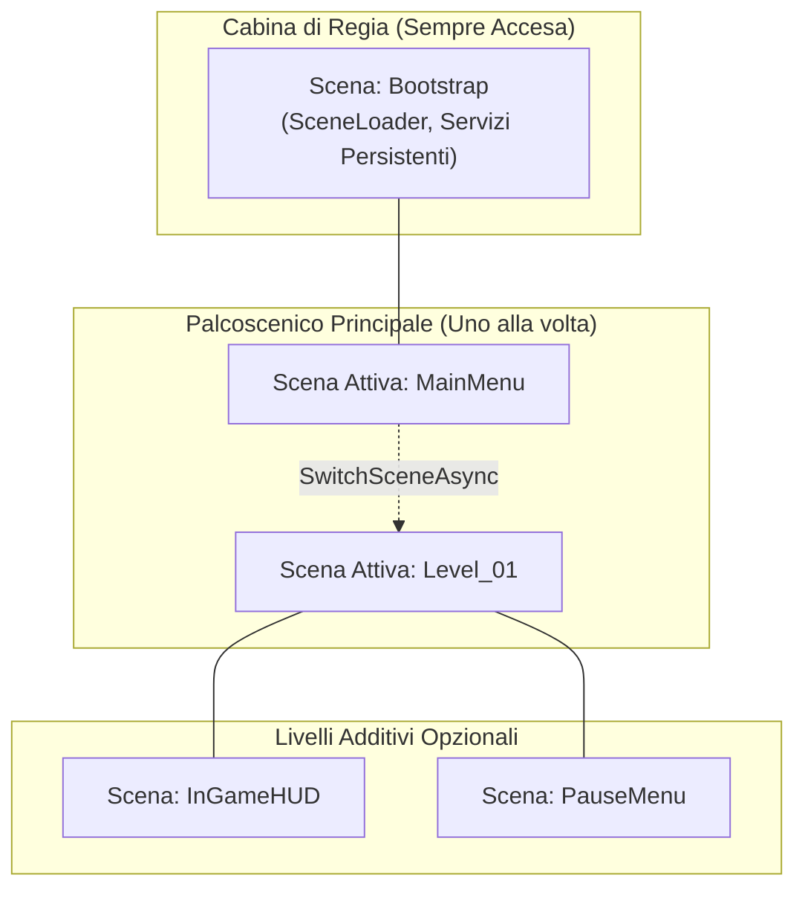
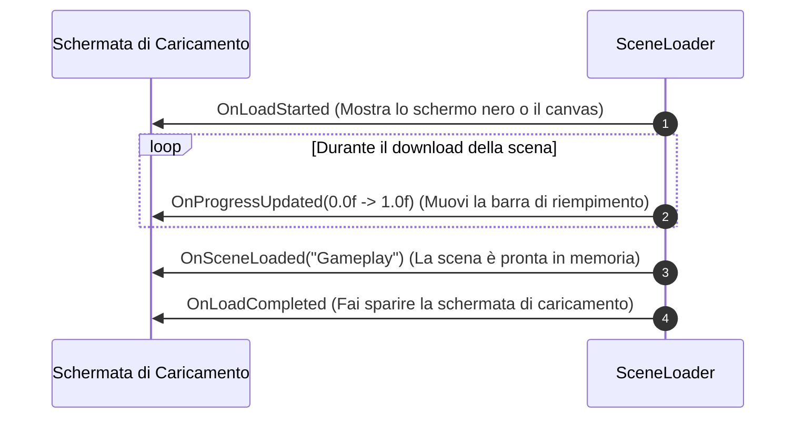

# Master Technical Design Document (TDD) — UnityTemplate

Documento di architettura tecnica generale del progetto. Pensato per essere chiaro, modulare e spiegato nel modo più semplice possibile ("Monkey-Proof").

---

## 🗺️ Mappa dei Sistemi (Architettura Generale)

| Modulo | Stato | Responsabile Principale | Descrizione Veloce |
|---|---|---|---|
| **01. Scene Management** | 🟩 **Attivo** | [`SceneLoader`](file:///c:/Users/francesco/Documents/Github/UnityTemplate/Assets/_Project/Architecture/Managers/SceneLoader.cs) | Gestione ibrida additiva delle scene, transizioni, memoria e persistenza. |
| **02. Audio Service** | ⬜ *Pianificato* | `AudioService` | Gestione musica di sottofondo (BGM), effetti sonori (SFX) e mixer audio. |
| **03. UI Framework** | ⬜ *Pianificato* | `UIManager` | Stack di viste, finestre modali, transizioni fade e navigazione con gamepad. |
| **04. Save & State System** | ⬜ *Pianificato* | `SaveManager` | Salvataggio dati locale/cloud, serializzazione e stato globale persistente. |
| **05. Input Handling** | ⬜ *Pianificato* | `InputReader` | Integrazione New Input System tramite eventi C# disaccoppiati. |

---

## 📦 01. Scene Management (`SceneLoader`)

### 🐒 Spiegazione "Monkey": La Metafora del Teatro

Immagina il tuo videogioco come un teatro:
1. **La Scena `Bootstrap` è la Cabina di Regia:**
   - Si accende all'avvio del gioco e **non si spegne mai**.
   - Ci vivono i manager che controllano tutto (come lo `SceneLoader`).
   - Non toccarla, non scaricarla, non metterci dentro i nemici o la grafica di gioco.
2. **Le Scene di Contenuto (`MainMenu`, `Level_01`, ecc.) sono il Palcoscenico:**
   - C'è solo una scena principale attiva alla volta.
   - Quando cambi livello, gli attori vecchi escono, si pulisce il pavimento da terra (scarico memoria RAM/VRAM con `UnloadUnusedAssets`), ed entrano i nuovi attori.
3. **Le Scene Additive (`HUD`, `Minimappa`, `Inventario`) sono gli Oggetti di Scena:**
   - Sono livelli extra che puoi montare e smontare sopra al palcoscenico senza cacciare via gli attori.



---

### 🎮 Le 3 Cose che puoi fare

1. **`SwitchSceneAsync` (Cambia stanza principale)**
   - *Cosa fa sotto il cofano:*
     1. Scarica la scena attiva precedente.
     2. Butta via gli asset rimasti orfani in memoria (`Resources.UnloadUnusedAssets`).
     3. Carica la nuova scena in modalità additiva.
     4. La imposta come scena attiva in Unity.
   - *Ritorna:* `true` se il cambio è riuscito, `false` se c'è stato un problema o cancellazione.

2. **`LoadAdditiveAsync` (Aggiungi un livello sopra)**
   - *Cosa fa:* Carica una scena in più senza toccare quella attuale. Se è già caricata, non fa nulla di stupido ed esce subito.

3. **`UnloadSceneAsync` (Togli un livello aggiunto)**
   - *Cosa fa:* Scarica solo quella scena specifica ed esegue opzionalmente la pulizia della memoria.

---

### ⚡ Come si usa (Codice da copiare)

#### Da Codice C# (con `await`)

```csharp
using UnityEngine;

public class GameFlowExample : MonoBehaviour
{
    [SerializeField] private SceneField gameplayScene; // Evita errori di battitura nelle stringhe!

    public async void StartGame()
    {
        // Modo raccomandato: tramite SceneField
        bool success = await SceneLoader.Instance.SwitchSceneAsync(gameplayScene);

        if (!success)
        {
            Debug.LogError("Impossibile caricare la scena!");
            return;
        }

        Debug.Log("Siamo nel gameplay!");
    }

    public async void OpenPauseMenu()
    {
        // Carica la schermata di pausa sopra al gioco
        await SceneLoader.Instance.LoadAdditiveAsync("PauseMenuScene");
    }

    public async void ClosePauseMenu()
    {
        // Chiude e scarica la schermata di pausa
        await SceneLoader.Instance.UnloadSceneAsync("PauseMenuScene");
    }
}
```

#### Da un Bottone dell'Inspector (Zero Codice!)
Se vuoi cambiare scena cliccando un bottone della UI senza scrivere nemmeno una riga di C#:
1. Seleziona il tuo `Button` nella gerarchia.
2. Nella sezione **On Click ()**, clicca sul `+`.
3. Trascina l'oggetto `SceneLoader` (presente nella scena `Bootstrap`).
4. Nel menu a tendina seleziona: `SceneLoader -> SwitchScene (string)`.
5. Digita il nome esatto della scena target (es. `MainMenu`).

---

### 📊 Come mostrare una Barra di Caricamento (Eventi)

Lo `SceneLoader` non tocca direttamente la grafica: emette eventi a cui qualsiasi UI può agganciarsi.



#### Esempio di Barra UI pronta all'uso:
```csharp
using UnityEngine;
using UnityEngine.UI;

public class LoadingScreenUI : MonoBehaviour
{
    [SerializeField] private GameObject screenRoot;
    [SerializeField] private Slider progressBar;

    private void OnEnable()
    {
        SceneLoader.Instance.OnLoadStarted += HandleLoadStarted;
        SceneLoader.Instance.OnProgressUpdated += HandleProgressUpdated;
        SceneLoader.Instance.OnLoadCompleted += HandleLoadCompleted;
    }

    private void OnDisable()
    {
        if (SceneLoader.Instance == null) return;
        SceneLoader.Instance.OnLoadStarted -= HandleLoadStarted;
        SceneLoader.Instance.OnProgressUpdated -= HandleProgressUpdated;
        SceneLoader.Instance.OnLoadCompleted -= HandleLoadCompleted;
    }

    private void HandleLoadStarted()
    {
        screenRoot.SetActive(true);
        progressBar.value = 0f;
    }

    private void HandleProgressUpdated(float progress)
    {
        progressBar.value = progress;
    }

    private void HandleLoadCompleted()
    {
        screenRoot.SetActive(false);
    }
}
```

---

### 🛡️ Regole Difensive (Cosa NON fare e come il codice ti salva)

| Situazione da scimmia 🐒 | Cosa succede dietro le quinte 🛡️ |
|---|---|
| **Spammi il bottone "Gioca" 10 volte di fila** | Lo `SceneLoader` controlla `IsLoading`. Se un'operazione è già in corso, ignora tutti i click successivi e ti avverte con un warning giallo in console. |
| **Il gioco è in pausa (`Time.timeScale == 0`)** | Unity a volte congela le coroutine tradizionali. Con i nuovi `Awaitable`, il caricamento asincrono continua a funzionare regolarmente, ma ti stampa un warning difensivo per ricordarti che il tempo di gioco è fermo. |
| **Dimentichi di mettere la scena nei `Build Settings`** | Lo `SceneLoader` verifica prima la presenza della scena. Se non esiste, non causa eccezioni non gestite: scrive un errore chiaro in console e restituisce `false`. |
| **Chiami per sbaglio `UnloadScene("Bootstrap")`** | La scena `Bootstrap` è protetta da un blocco ferreo. Lo scaricamento viene rifiutato a prescindere per impedire la distruzione dei manager globali. |

---

### 🔍 Riferimento Rapido alle Interfacce

I componenti interagiscono con [`ISceneLoader`](file:///c:/Users/francesco/Documents/Github/UnityTemplate/Assets/_Project/Architecture/Managers/ISceneLoader.cs):

```csharp
public interface ISceneLoader
{
    // Stato
    bool IsLoading { get; }
    string CurrentActiveSceneName { get; }

    // Eventi
    event Action OnLoadStarted;
    event Action<float> OnProgressUpdated;
    event Action<string> OnSceneLoaded;
    event Action<string> OnSceneUnloaded;
    event Action OnLoadCompleted;

    // Metodi Asincroni (Unity 6 Awaitable)
    Awaitable<bool> SwitchSceneAsync(string sceneName, bool cleanUnusedAssets = true, CancellationToken cancellationToken = default);
    Awaitable<bool> SwitchSceneAsync(SceneField sceneField, bool cleanUnusedAssets = true, CancellationToken cancellationToken = default);

    Awaitable<bool> LoadAdditiveAsync(string sceneName, bool setActive = false, CancellationToken cancellationToken = default);
    Awaitable<bool> LoadAdditiveAsync(SceneField sceneField, bool setActive = false, CancellationToken cancellationToken = default);

    Awaitable<bool> UnloadSceneAsync(string sceneName, bool cleanUnusedAssets = true, CancellationToken cancellationToken = default);
    Awaitable<bool> UnloadSceneAsync(SceneField sceneField, bool cleanUnusedAssets = true, CancellationToken cancellationToken = default);

    // Controlli
    bool IsSceneLoaded(string sceneName);
    bool IsSceneLoaded(SceneField sceneField);
}
```
